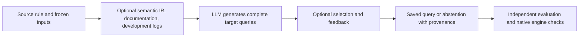

# Cross-Cloud Detection Rule Transfer

**Ongoing R&D · Detection engineering · LLM evaluation**

I'm investigating whether additional reasoning and evidence-processing steps help an LLM translate a cloud detection rule while preserving what it detects. The same operation can have different names, fields, scopes, and available history across cloud providers. A query can be syntactically valid and still detect the wrong behavior.

This is the public overview of my SFU team research. The working implementation and evaluation material remain in a separate private repository.

## My work

My documented work centers on the experiment framework and evaluation workflow: organizing source-rule provenance, designing comparisons, integrating and reviewing the orchestration code, defining evidence requirements, and preparing cloud validation. I use AI-assisted implementation and review and verify the resulting artifacts. Semantic-IR contributions are being developed with a teammate and require integration review; I do not claim sole authorship of the team's work.

## Current evidence

| Evidence | Verified record | What it establishes |
| --- | --- | --- |
| Offline software checks | **188 passing tests** in the standalone working repository. | Tested framework behavior, not translation accuracy. |
| Full fake-model grid | **270 configurations, 884 allowed ordered conditions**; all 884 reached `needs_evaluation`. | End-to-end orchestration. The checker and model were fake services. |
| Resume behavior | **Zero additional calls** on a completed fake-model batch. | Recorded resume behavior for that check. |
| Local inference smoke test | **One Qwen3 1.7B call**, four invented events, expected JSON result, no truncation. | Local inference and output handling. This was not a cloud-rule translation. |
| Earlier AWS exercises | Three original CloudWatch queries matched their corresponding S3, EBS, and SSM exercise events. | Telemetry delivery and example query matching, separately from cross-cloud evaluation. |

[Verification details](docs/verification-and-limits.md) · [Sanitized verification summary](evidence/verification-summary.json) · [Earlier AWS validation](docs/aws-telemetry-validation.md)

## Research workflow

The model generates the complete target query. Python manages inputs, stage order, budgets, artifacts, and evaluation interfaces. [The design note](docs/experiment-design.md) explains the five process groups and the 270/884 distinction.

## What is still in progress

The ten selected source rules cover seven source clouds. They informed process development, so they are not unseen-rule holdouts. Source provenance is recorded, but target mappings, hidden scenarios, reference answers, final scoring, and native target-engine validation still need independent review. Embedding-model selection and final study settings are also pending.

There is no reported cross-cloud accuracy score or demonstrated improvement over baseline yet. The [evaluation plan](docs/evaluation-plan.md) keeps those open questions explicit.

**Relevant skills:** Python research tooling, cloud telemetry, detection semantics, experimental design, test isolation, provenance, cost accounting, and code review.

Related work: [home lab](https://github.com/RDMRock/home-cybersecurity-lab) · [cybersecurity coursework](https://github.com/RDMRock/cybersecurity-lab-portfolio).
